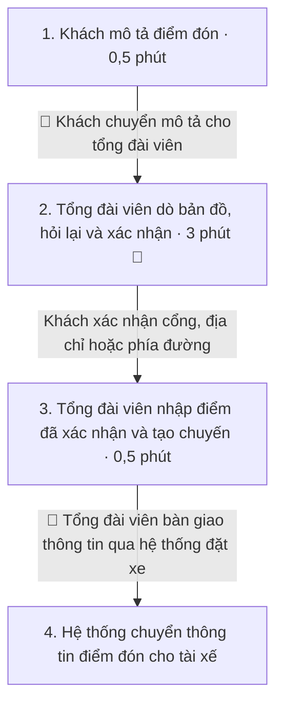
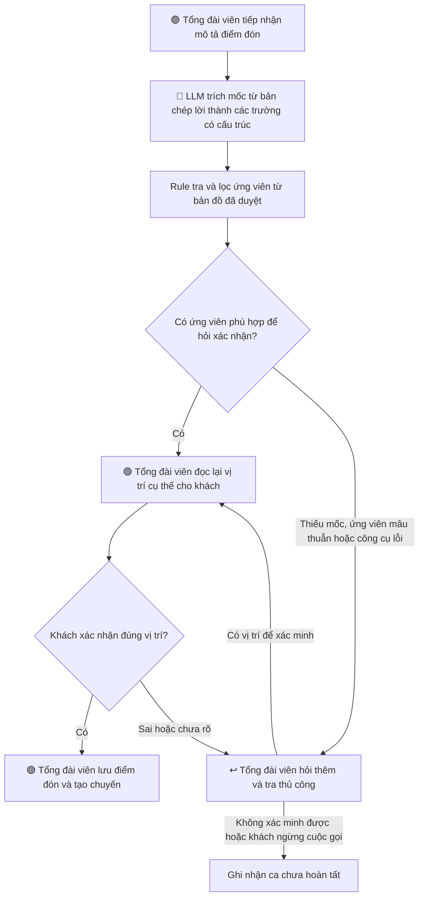

# Deep Dive — Xác minh điểm đón qua tổng đài Xanh SM

**Vin Smart Future · Xanh SM (GSM) · Card #1**

Phạm vi đề xuất gồm các cuộc gọi đặt taxi mà khách mô tả điểm đón mơ hồ, chẳng hạn bằng tên cổng, mốc gần đó hoặc phía đường. Nhóm đo từ lúc tổng đài viên bắt đầu tra cứu theo mô tả đến khi nhập điểm đón đã được khách xác nhận. Quy trình, khối lượng và thời gian dưới đây là giả định cần xác minh với đội tổng đài. [Problem Scan, Card #1](01-problem-scan.md#card-1--xác-minh-điểm-đón-qua-tổng-đài)

## Phase 3 — DEEP-DIVE

### 3.1. Current-State Workflow Mapping

| Bước | Người thực hiện | Đầu vào → đầu ra | Thời gian giả định |
|---|---|---|---:|
| 1. Tiếp nhận mô tả | Khách và tổng đài viên | Mô tả bằng lời → mốc ban đầu để tra cứu | 0,5 phút |
| 2. Dò và xác nhận 🔴 | Tổng đài viên và khách | Mốc ban đầu và bản đồ → địa điểm khách xác nhận | 3 phút |
| 3. Nhập điểm và tạo chuyến | Tổng đài viên | Địa điểm đã xác nhận → điểm đón được lưu và chuyến được tạo | 0,5 phút |
| 4. Bàn giao | Hệ thống đặt xe | Thông tin chuyến → điểm đón hiển thị cho tài xế | Đo riêng độ trễ hệ thống |

Một lượt tạo chuyến có khoảng **4 phút thao tác giả định** ở bước 1–3. Chỉ số thời gian bổ sung của pilot đo **từ khi bắt đầu bước 2 đến khi lưu điểm đón ở bước 3**, bao gồm hỏi lại, chờ gợi ý, xác nhận và sửa điểm trước khi lưu. Card #1 đặt mốc 3 phút riêng cho bước dò và xác nhận. Pilot đo baseline cho cả hai khoảng thời gian. Với ca chưa lưu được điểm, đồng hồ dừng khi tổng đài viên kết thúc xử lý và ca được tính riêng vào tỷ lệ chưa hoàn tất.

### 3.2. Problem Statement và Metrics

| Trường | Nội dung |
|---|---|
| **1. Actor / Operator** | Tổng đài viên đặt xe tra cứu và nhập điểm đón. Khách xác nhận vị trí. Tài xế nhận điểm đón từ hệ thống đặt xe. |
| **2. Current Workflow** | Khách mô tả → tổng đài viên dò bản đồ và hỏi lại → khách xác nhận → tổng đài viên nhập điểm và tạo chuyến → hệ thống bàn giao thông tin cho tài xế. |
| **3. Bottleneck** | Bước dò và xác nhận mất khoảng 3 phút/ca theo giả định. Một tên địa điểm có thể có nhiều cơ sở, cổng hoặc phía đường. Nhân viên phải hỏi lại khi mô tả chưa phân biệt được các vị trí. |
| **4. Business Impact** | Với 1.200 ca/tháng, giảm bước 2 từ 3 xuống 2 phút sẽ giải phóng khoảng **20 giờ công tổng đài/tháng**, trị giá **2 triệu đồng/tháng** theo đơn giá giả định 100.000 đồng/giờ. Giá trị tăng thêm của AI phải tính trên chênh lệch so với phương án tra cứu bằng quy tắc. |
| **5. Success Metric** | Bước 2 đạt trung bình **≤2 phút/ca** trên toàn bộ ca đủ điều kiện, gồm cả fallback. Đo thêm thời gian từ bắt đầu tra cứu đến khi lưu điểm để phát hiện công việc bị dồn sang bước nhập. **≥98%** điểm đã lưu phải khớp địa điểm khách xác nhận. Báo cáo riêng tỷ lệ ca đủ điều kiện lưu được điểm đã xác nhận để theo dõi các ca bị bỏ dở. |
| **6. Operational Boundary** | AI trích mốc từ lời khách và gợi ý ứng viên lấy từ nguồn bản đồ đã duyệt. Tổng đài viên xác nhận lại với khách, chọn hoặc nhập điểm và tạo chuyến. Thiếu thông tin để phân biệt ứng viên, bản đồ thiếu dữ liệu hoặc công cụ lỗi thì chuyển sang hỏi lại và tra cứu thủ công. |

### 3.3. Future-State Flow và AI Fit

| Phương án | Vai trò trong pilot |
|---|---|
| **Rule / State Machine** | Tổng đài viên nhập địa chỉ hoặc từ khóa. Code chuẩn hóa tên đường, tên gọi tắt và danh mục địa điểm, lọc theo khu vực, rồi trả ứng viên từ bản đồ. Đây là phương án đối chứng có thể triển khai độc lập. |
| **LLM Feature + Rule** | LLM trích tên địa điểm, cơ sở, cổng, phía đường và mốc gần đó từ bản chép lời. Code dùng các trường này để tra cùng nguồn bản đồ và lọc ứng viên. Phần cần chứng minh là khả năng xử lý mô tả tự do giúp giảm số lượt tra và hỏi lại so với đối chứng. |
| **Agentic Loop** | Luồng thử nghiệm có một bước trích xuất, một bước tra cứu và một điểm duyệt. Thiết kế dùng luồng cố định để đội tổng đài có thể kiểm tra từng gợi ý và tái hiện kết quả. |

**Ví dụ giả lập.** Khách nói “cổng phụ bệnh viện, đối diện nhà thuốc”. Mô hình trích loại cổng và mốc đối diện. Nếu tên bệnh viện hoặc cơ sở vẫn chưa rõ, tổng đài viên hỏi thêm trước khi chọn. Nếu bản đồ chỉ trả vị trí tòa nhà và thiếu dữ liệu về cổng, nhân viên tiếp tục luồng thủ công. Khi khách chưa xác nhận được điểm đón, ca được ghi nhận là chưa hoàn tất.

**Quyền và dữ liệu.** Công cụ gợi ý chỉ có quyền đọc nguồn bản đồ đã duyệt. Giao diện hiển thị tên, địa chỉ và nguồn ứng viên để tổng đài viên kiểm tra. Pilot ngoại tuyến dùng mô tả giả lập hoặc đoạn chép lời được phép sử dụng đã bỏ thông tin nhận dạng không cần thiết. Bản ghi âm thật chỉ dùng khi có quyền sử dụng phù hợp.

## Phase 5 — EVALUATE

### AI Readiness Checklist

| Câu hỏi | Đánh giá hiện tại | Bằng chứng cần có |
|---|---|---|
| Có dữ liệu mẫu sạch để kiểm thử? | **Chưa xác nhận.** | Mẫu mô tả được phép dùng, điểm đón khách đã xác nhận, dữ liệu bản đồ tương ứng và đủ ca dễ nhầm cổng hoặc cơ sở. |
| Rủi ro khi AI sai có trong tầm kiểm soát? | **Có thiết kế kiểm soát, cần thử.** | Kiểm tra tên trùng, cổng không có trên bản đồ, bản chép lời sai, công cụ mất kết nối và khách từ chối gợi ý. Kiểm tra điểm lưu nào cũng có xác nhận của khách qua tổng đài viên. |
| Người vận hành sẵn sàng thay đổi quy trình? | **Chưa xác nhận.** | Đầu mối tổng đài đồng ý phạm vi thử, cách đo và quy trình quay về tra cứu thủ công. |

### Kế hoạch đo pilot

1. **Đo lại baseline trong 4 tuần.** Đếm ca điểm đón mơ hồ theo mã cuộc gọi và lấy mẫu theo khung giờ, khu vực và dạng mơ hồ. Ghi riêng thời gian dò và xác nhận, tổng thời gian đến khi lưu, số lượt hỏi lại và ca chưa hoàn tất.
2. **So sánh thủ công, Rule và LLM + Rule.** Dùng cùng phiên bản bản đồ và các nhóm ca tương đương. Để tách giá trị của LLM, hai phương án tự động nhận cùng bản chép lời và dùng cùng bộ lọc bản đồ. Phân ca để cùng một nhân viên không xử lý lại tình huống đã thấy đáp án. Ghi thời gian thực tế, gồm chờ công cụ, sửa gợi ý và fallback. Khi đánh giá khả năng triển khai, tính thêm độ trễ và chi phí nhận dạng giọng nói nếu phải bổ sung.
3. **Chấm chất lượng và công bố mẫu số.** Lấy số điểm lưu khớp vị trí đã xác nhận chia cho toàn bộ điểm lưu trong mẫu. So vị trí theo cổng hoặc phía đường khi khách đã nêu chi tiết này. Báo cáo số ca chưa lưu được điểm trên toàn bộ ca đủ điều kiện, số lỗi theo nhóm tình huống và thời gian của cả ca fallback. Định cỡ mẫu theo mức sai số chấp nhận được quanh ngưỡng 98% trước khi thử. Ca giả lập dùng để thử ranh giới và lỗi hiếm.
4. **Tính lợi ích tăng thêm.** Giá trị giờ công tăng thêm mỗi tháng = (phút trung bình của Rule − phút trung bình của LLM + Rule) × số ca/tháng ÷ 60 × đơn giá giờ công. Dùng thời gian từ bắt đầu tra cứu đến khi lưu để so lợi ích, đồng thời đối chiếu tỷ lệ hoàn tất. Với 1.200 ca/tháng và 100.000 đồng/giờ, mỗi **0,1 phút/ca** tiết kiệm thêm tương đương **200.000 đồng/tháng**. Ví dụ, nếu AI tiết kiệm thêm **0,3 phút/ca**, giá trị tăng thêm là **600.000 đồng/tháng**, trước chi phí tăng thêm về công cụ, tích hợp và vận hành. Khoản quy đổi này thể hiện năng lực tổng đài được giải phóng.

### Quyết định — NOT YET

**Cho phép làm bản mẫu ngoại tuyến. Việc thử trong tổng đài chờ số đo và xác nhận của đội vận hành.** Chuyển sang **GO cho pilot có giám sát** khi có dữ liệu được phép dùng, bước dò và xác nhận đạt mục tiêu thời gian, chất lượng đạt ngưỡng 98%, tỷ lệ hoàn tất ít nhất bằng phương án Rule và toàn bộ điểm lưu có xác nhận của khách. Luồng AI còn phải giảm thời gian đến lúc lưu so với Rule và tạo giá trị giờ công tăng thêm đủ bù chi phí tăng thêm.

Chọn **NO-GO cho phần LLM** nếu phương án Rule đạt yêu cầu vận hành và phép thử cho thấy giá trị tăng thêm của LLM không bù chi phí. Nếu mẫu quá nhỏ hoặc dữ liệu bản đồ thiếu chi tiết ở các điểm đón chính, giữ **NOT YET** và ghi rõ dữ liệu cần bổ sung.
